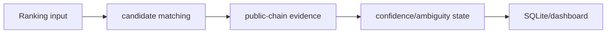

# Public Wallet Resolver

**Resolve masked ranking entries while preserving evidence and ambiguity.**

  [](LICENSE)

[Overview](#overview) · [Quickstart](#quickstart) · [Example](#example) · [Validation](#validation) · [Documentation](#documentation)

## Overview

A read-only BSC analysis toolkit for resolving masked ranking entries against public transaction evidence.

**Stack:** JavaScript · Node.js 24 · SQLite · JSON-RPC · Redis protocol adapter · local dashboard

## Matching has more than one outcome

| Component | Behavior |
| --- | --- |
| Resolved | Candidate evidence supports a matching address under the implemented rules. |
| Ambiguous | Multiple candidates remain and need further evidence. |
| Unresolved | Available input is insufficient for a match. |

## Processing path



## Quickstart

```console
node --test test/amounts.test.js test/dashboard-data.test.js test/decoder.test.js test/intel-db.test.js test/rank-history.test.js test/resolve.test.js test/router-purchases.test.js test/sync-data.test.js test/wallet-enrichment-db.test.js
```

The commands above install prerequisites or run the specified offline checks. Live collection, cloud operations, messaging and trading are separate operational steps when present.

## Example

**Inspect the workflow**

Inspect resolver fixtures for masked-address matching and ambiguity. Router/event observations contribute public evidence; SQLite retains enrichment and history for the dashboard. Report the match state and its evidence rather than converting a ranking correlation into personal identity.

## Configuration and storage

Node.js 24+, SQLite and JSON-RPC readers. Live scans need supplied ranking input and local RPC configuration. Redis-protocol output and browser synchronization have separate integration paths.

## Repository guide

| Location | Responsibility |
| --- | --- |
| [src/cli.js](src/cli.js) | Research CLI |
| [src/resolve.js](src/resolve.js) | Address resolution |
| [src/dashboard-data.js](src/dashboard-data.js) | Dashboard projection |
| [test](test) | Offline regression cases |

## Validation

These checks use offline fixtures or controlled backends.

## Scope and operational boundaries

Wallet/address correlation does not prove who controls an account. Browser synchronization mutates external browser state and is distinct from read-only chain analysis. Fixtures do not establish current provider coverage.

## Documentation

- The repository guide above links directly to the implementation and configuration files.

## License and attribution

Project-authored source code is licensed under the [MIT License](LICENSE). Third-party components and datasets retain their respective rights and licenses.
